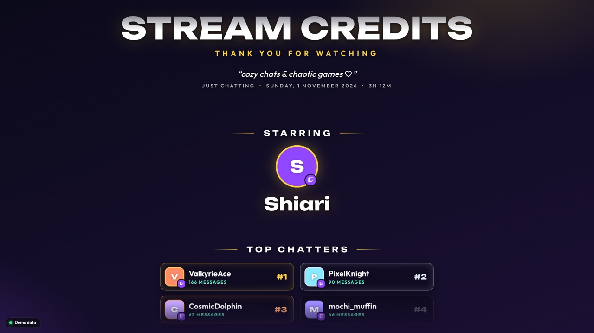

# Quick start

This gets end credits onto your stream. It takes about 10 minutes and you only do it once. You'll need OBS and your Twitch account.

## 1. Get a Twitch Client ID (one time)

> **Skip this step** if the setup page only shows a purple **Connect with Twitch** button and no "Client ID" box.

1. Go to [dev.twitch.tv/console/apps](https://dev.twitch.tv/console/apps), log in with Twitch, and click **Register Your Application**. Twitch needs two-factor authentication turned on for your account first.
2. Fill in the form:
   - **Name:** anything nobody else has used, e.g. `yourname-stream-credits`
   - **OAuth Redirect URLs:** `https://aniket-patel-ef.github.io/stream-credits/` (then click **Add**)
   - **Category:** Broadcaster Suite
   - **Client Type:** Public
3. Click **Create**, then **Manage** next to your new app, and copy the **Client ID**.

## 2. Connect and choose a look

1. Open the setup page: **https://aniket-patel-ef.github.io/stream-credits/**
2. Paste the Client ID into the box and click **Connect with Twitch**, then **Authorize** on Twitch. You'll come back to the page and see "Connected as *your name*".
3. Under **Make it yours**, pick a theme (Glass, Kawaii or Cinema) and change the colours and texts if you like. The preview on the right shows exactly what it will look like. Your choices are saved automatically.

## 3. Put it in OBS

1. On the setup page, click **Copy OBS link**.
   > The link has your Twitch login in it. Don't paste it in chat or show it on stream.
2. In OBS, go to your ending scene. If you don't have one, click **+** under Scenes and call it "Ending".
3. Under Sources, click **+** → **Browser**, name it "Credits", and click **OK**.
4. In the window that opens:
   - **URL:** paste the link
   - **Width:** 1920 · **Height:** 1080
   - **Shutdown source when not visible:** leave it **off**
   - **Refresh browser when scene becomes active:** leave it **off**
   - Click **OK**.
5. Make sure "Credits" is at the top of that scene's source list, so it sits in front of everything else.

## 4. Stream

- **Just stream like normal.** As long as OBS is open, the credits keep counting in the background, even when the ending scene isn't showing.
- **At the end of the stream, switch to your ending scene.** The credits rise up from the bottom and stop on "See you next stream".
- **Every new stream starts with fresh credits.** You don't have to reset anything.

## Want it on your offline screen too?

1. On the setup page:
   - set **Background** to **Solid (offline screen)**;
   - tick **Loop forever**;
   - set **Start rolling** to **As soon as the source loads**.
2. Click **Copy OBS link** again.
3. Add it as a second Browser source in your offline scene, with the same settings as in step 3.

Both copies show the same people. Your first source keeps its own look, because each link carries its own settings.

> **Changing the look later?** After changing settings on the setup page, copy the link again. Then double-click the source in OBS and paste the new link into **URL**.

## If something's not right

| What's happening | What to do |
|---|---|
| I want to check it's counting | Right-click the Credits source → **Interact**, then press **D**. A small panel shows the messages, follows and subs counted so far. Press **D** again to hide it. |
| Nothing rolls when I switch scenes | Double-click the source and check **Shutdown source when not visible** is off. You can also roll the credits by hand: right-click → **Interact** → press **R**. |
| A red notice says the Twitch token expired | Twitch logins run out after a while. Open the setup page, click **Connect with Twitch** again, then **Copy OBS link**, and paste the new link into the source's **URL**. |
| The credits are almost empty | It only counts while OBS is open and the source exists, so anything before that isn't included (except new followers, which it catches up on). |
| A bot or my alt account shows up | On the setup page, type its name into **Leave these accounts out**, then copy the link into OBS again. Nightbot, StreamElements and similar bots are already left out. |
| I want to start counting from zero mid-stream | Right-click → **Interact** → press **Shift + X** twice. |

Want all the details, like every option and how the ranking works? See the [full README](README.md).
