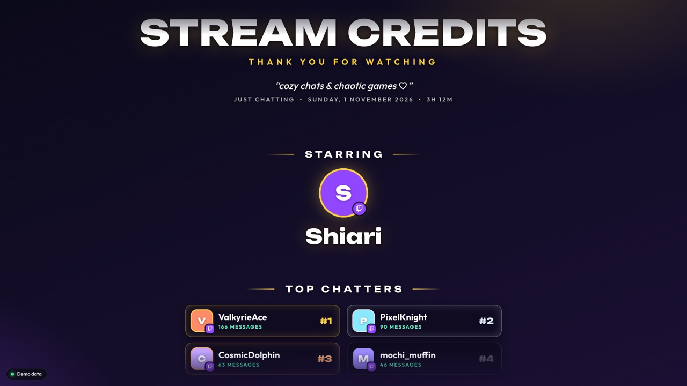
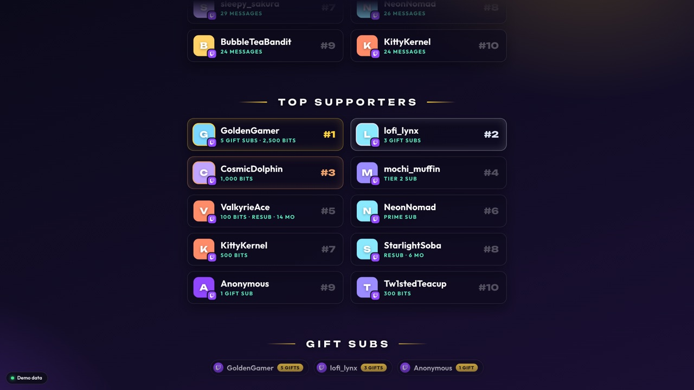
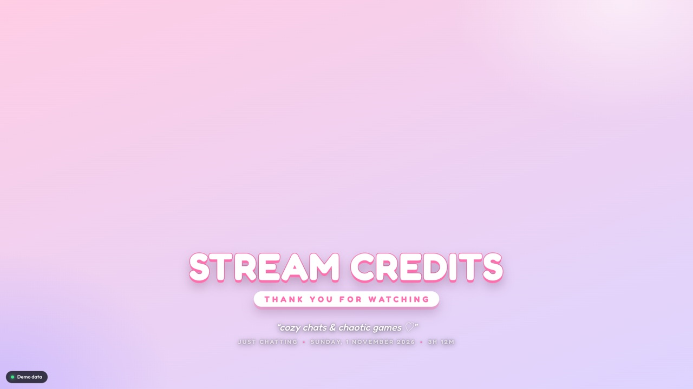
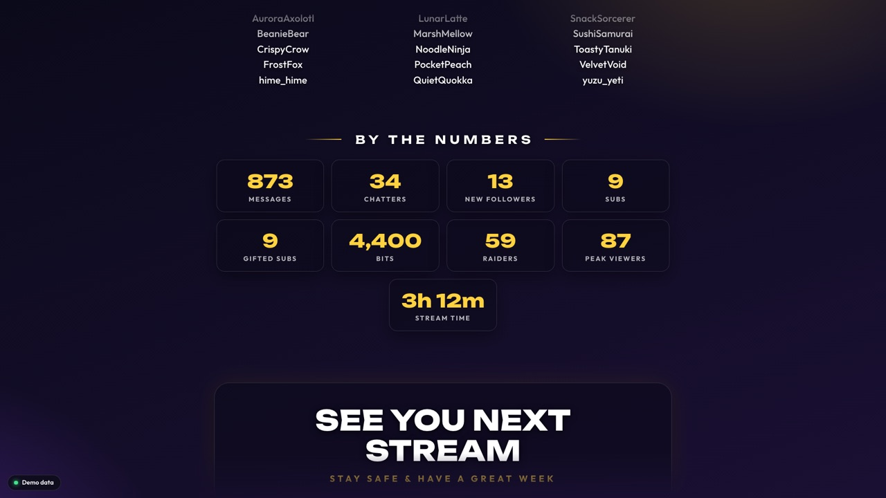

# Stream Credits

Movie-style end credits for Twitch streams. It's one OBS browser source: it listens to your channel while you stream, then rolls a credits sequence of the people who showed up. There's no server, no Streamlabs account and nothing to install.

**Setup page:** https://aniket-patel-ef.github.io/stream-credits/ · **Try it:** [demo credits](https://aniket-patel-ef.github.io/stream-credits/credits.html#demo=1&start=load&loop=1&bg=solid) with made-up data



| | |
|---|---|
|  |  |
|  | Three themes: **Glass**, **Kawaii** and **Cinema** (classic serif "role … name" credits). |

## What it shows

Each section only appears if something happened in it. You choose which sections to show and their order.

| Section | What's in it |
|---|---|
| Starring | You |
| Top Chatters | The people who sent the most messages, with avatars, ranked |
| Top Supporters | Ranked by bits + gifted subs + their own sub |
| Gift Subs | Everyone who gifted, with counts (a 10-gift bomb counts as 10, once) |
| Subscribers | New subs, resubs (with months), Prime, gifted and upgraded subs |
| Bits | Everyone who cheered |
| Raided By | Raiders, with how many people they brought |
| New Followers | Everyone who followed during the stream, in order |
| Moderators | Mods who chatted |
| Chat | Everyone who chatted, in order of appearance |
| Lurkers | People who were in chat but never typed |
| By the Numbers | Messages, chatters, followers, subs, gifts, bits, raiders, peak viewers, stream length |

Known bots (Nightbot, StreamElements, Streamlabs, Moobot, Fossabot, …) and you are left out of the lists. You can hide more names, too.

## How it works

```
Twitch EventSub (WebSocket) ──► credits.html in OBS ──► localStorage (one session per stream)
     chat · follows · subs                                   │
     gifts · bits · raids                                    ▼
Twitch Helix (polling) ─────►  stream info, past follows,   rolls when the scene goes live
                               who's in chat, avatars
```

- Your browser source loads when OBS starts and keeps listening even while its scene is hidden. That's why **"Shutdown source when not visible" must stay unchecked**.
- When the scene holding the source goes live (Program), the credits roll from the bottom. They stop on an end card in the middle of the screen. When you switch away, they reset.
- Each Twitch broadcast gets its own session:
  - Chat from before you hit "Go live" still counts.
  - Counting continues for 30 minutes after you end, for the raid-out and "o7"s.
  - The next stream starts fresh, and the previous one is archived.
- If you add the source to several scenes, only one copy collects (using a browser lock). The others display the same data.
- Everything stays on your PC. The Twitch login is read-only: it can read chat, followers and the chatter list, and can't post anything.

## Setup

### 1. Register a Twitch app (one time, 2 minutes)

1. Go to [dev.twitch.tv/console/apps](https://dev.twitch.tv/console/apps) and click **Register Your Application**.
2. **Name:** anything, e.g. `sia-stream-credits` (it must be unique on Twitch).
3. **OAuth Redirect URLs:** the address of the setup page, exactly as the setup page shows it under "Where do I get a Client ID?". For example:
   - `https://aniket-patel-ef.github.io/stream-credits/` for the hosted setup page;
   - `https://<your-github-user>.github.io/stream-credits/` for your own fork on GitHub Pages;
   - `http://localhost:8125/` when running locally.

   You can add both.
4. **Category:** Broadcaster Suite. **Client Type:** Public.
5. Create the app and copy its **Client ID**.

Optionally, put the Client ID in [`js/config.js`](js/config.js) so the setup page only shows a **Connect** button. Client IDs are public, so committing one is fine.

### 2. Open the setup page

Use the hosted page at https://aniket-patel-ef.github.io/stream-credits/. You can also host your own copy (fork it and turn on GitHub Pages), so that OBS doesn't depend on a local server. Or run it locally:

```bash
npm start   # serves http://localhost:8125 (needs python3)
```

Open the setup page, paste the Client ID, click **Connect with Twitch**, then pick a theme, colours, texts, speed and sections. The live preview on the right updates as you change things.

### 3. Add it to OBS

1. Click **Copy OBS link**. It contains your login token, so treat it like a password and don't show it on stream.
2. In OBS, go to **Sources → + → Browser** and paste the link as the URL.
3. Set the size to **1920 × 1080**.
4. Leave **"Shutdown source when not visible"** unchecked, and leave **"Refresh browser when scene becomes active"** unchecked as well.
5. Put the source in your ending or offline scene, on top of your background or camera.

That's it. Stream as usual, then switch to that scene at the end.

**Checking it works:** in OBS, right-click the source, choose **Interact**, and press <kbd>D</kbd> to see a small stats panel with what's been counted so far.

## Options

The setup page writes these into the link for you. You can also edit the link by hand: everything after `#` is `key=value&key=value`.

| Key | Default | Meaning |
|---|---|---|
| `theme` | `glass` | `glass`, `kawaii` or `cinema` |
| `bg` | `none` | `none` (transparent, over your scene), `dim` (darkened) or `solid` (theme background) |
| `accent` | theme | Accent colour as hex without `#`, e.g. `ff6fae` |
| `title` / `tagline` | Stream Credits / Thank you for watching | Opening title card |
| `outro` / `outro2` | See you next stream / Stay safe & have a great week | End card |
| `speed` | `90` | Scroll speed in pixels per second at 1080p (10 to 1000) |
| `duration` | `0` | Fit the whole roll into this many seconds (overrides `speed`; `0` = use `speed`) |
| `hold` | `8` | Seconds the end card stays before finishing (or looping) |
| `loop` | off | `1` to roll again after the end card (offline or "be right back" screens) |
| `start` | `active` | `active` = roll when the scene goes live in OBS · `load` = roll as soon as the page loads · `manual` = only on <kbd>R</kbd> |
| `top` | `10` | How many people in the "Top" lists (1 to 50) |
| `sections` | all | Comma-separated, in the order you want: `starring,chatters,supporters,gifters,subs,cheers,raids,followers,mods,cast,lurkers,stats` |
| `ignore` | — | Extra comma-separated usernames to hide, e.g. `mybot,alt_account` |
| `showbots` | off | `1` to include the known bots |
| `scale` | `1` | Make everything bigger or smaller (0.4 to 3) |
| `channel` | your account | Track a different channel (for a mod setting it up for the streamer) |
| `demo` | off | `1` to show made-up data, for trying looks without a login |
| `debug` | off | `1` to always show the status pill and stats panel |
| `token` | — | Your Twitch login, set by the setup page |

### Keys (OBS: right-click the source → Interact)

| Key | Action |
|---|---|
| <kbd>R</kbd> | Roll the credits now |
| <kbd>S</kbd> | Stop |
| <kbd>D</kbd> | Show or hide the stats panel |
| <kbd>Shift</kbd>+<kbd>X</kbd> twice | Throw away this session and start counting from zero |

## Good to know

- **Login expiry.** Twitch logins made this way expire after a while, and the setup page shows the date. When it expires, the overlay shows a small red notice in its corner, even inside OBS: connect again and paste the new link into OBS. You can revoke access any time at [twitch.tv/settings/connections](https://www.twitch.tv/settings/connections).
- **Supporter ranking.** 1 bit = 1 point. Each Tier 1 / Tier 2 / Tier 3 sub (gifted or their own) = 500 / 1,000 / 2,500 points.
- **Follows** that happened before OBS was opened are fetched from Twitch when the source starts, back to the start of the stream.
- **Lurkers and followers** need the logged-in account to be the broadcaster or one of their moderators.
- **Shared chat** (Stream Together) messages from the other channels are ignored. Only your own chat counts.

## Development

No build step and no dependencies: plain HTML, CSS and JavaScript.

```
index.html, js/setup.js, css/setup.css     setup page (login, options, live preview)
credits.html, js/overlay.js                the OBS overlay
js/core.js       session model, event normalisation, credits builder (pure, unit tested)
js/twitch.js     OAuth helpers, Helix client, EventSub WebSocket client
js/collector.js  session lifecycle, storage, one-collector-per-channel lock
js/roller.js     renders the credits and runs the scroll
css/credits.css  overlay styles and themes
```

```bash
npm test         # node:test, needs Node 18+
npm start        # local server on :8125
```

`test/harness.html` runs the real overlay against a fake Twitch: a fake WebSocket and a fake Helix. It plays a simulated stream with chat, cheers, a resub, a gift bomb and a raid. Open `http://localhost:8125/test/harness.html` and press <kbd>R</kbd> to roll. In the dev console you can push your own events with `chat('42', 'SomeName')` or `notify(type, event)`.

## Not done yet

- Twitch only. YouTube and Kick would need their own collectors, but they could feed the same session model.
- Channel-point redemptions and hype trains aren't in the credits yet (they need extra Twitch permissions).

## License

MIT
